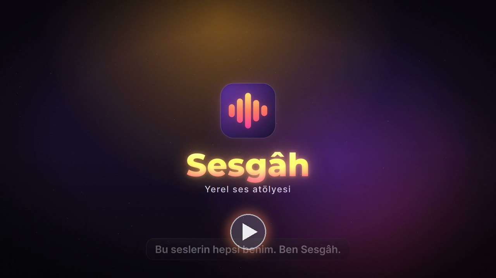
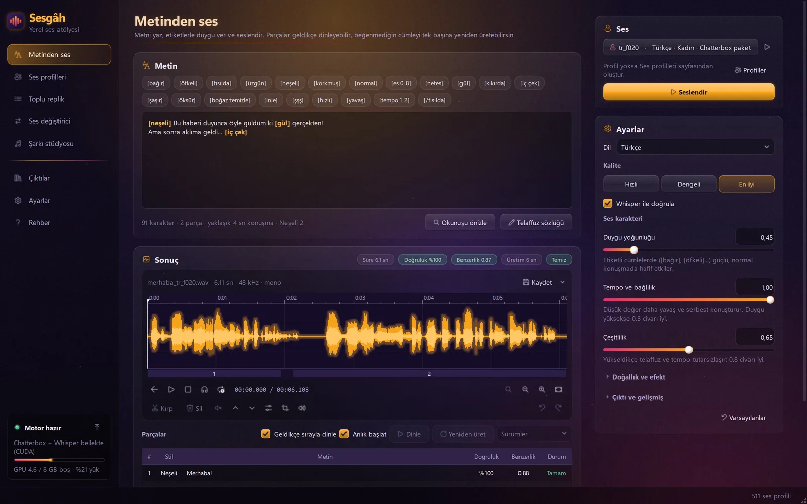
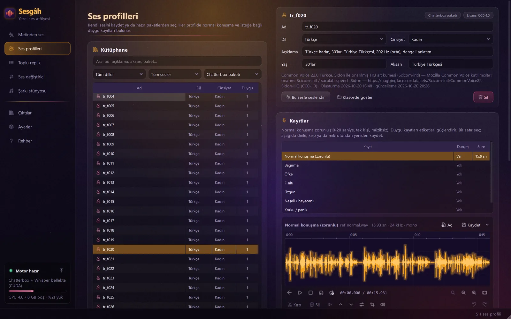
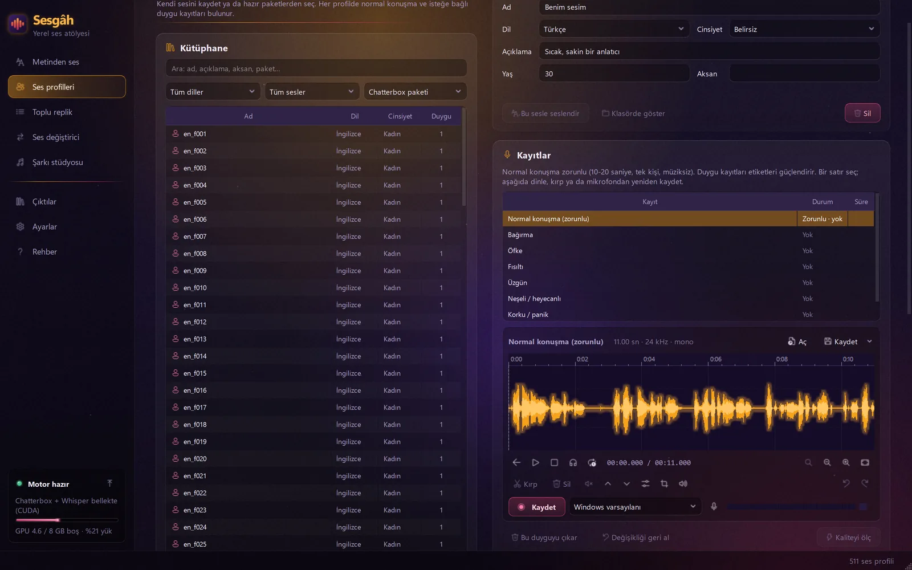
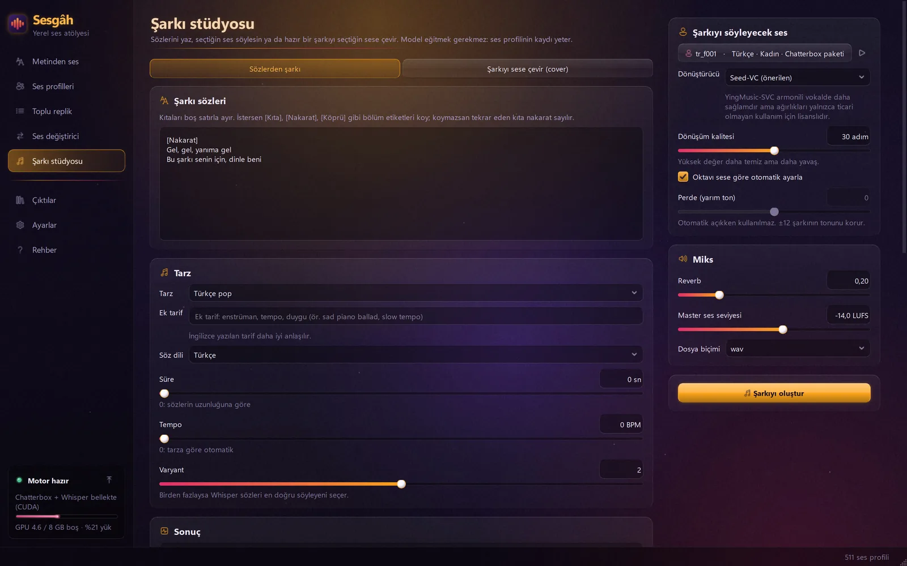
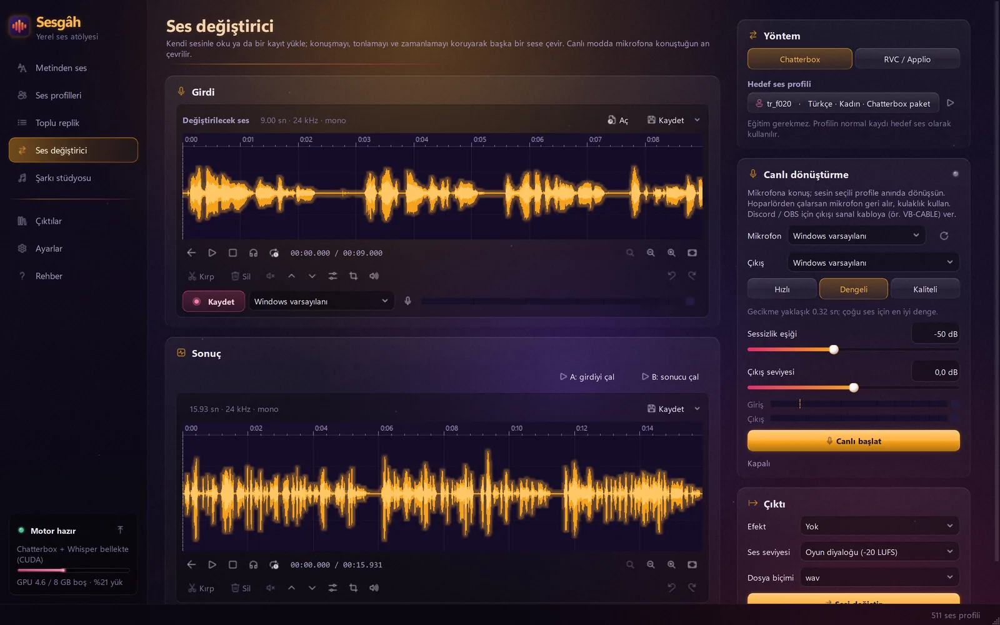

<p align="center">
  
</p>

<h1 align="center">Sesgâh</h1>

<p align="center">
  <b>Your voice studio that lives on your computer.</b><br>
  <b>Bilgisayarında yaşayan ses atölyesi.</b>
</p>

<p align="center">
  Windows · NVIDIA GPU · 23 languages / dil · 500+ voices / ses · 100% offline / tamamen yerel
</p>

<p align="center">
  <a href="https://feomatif.github.io/sesgah/"><b>feomatif.github.io/sesgah</b></a>
  &nbsp;·&nbsp; <a href="#türkçe">Türkçe</a> &nbsp;·&nbsp; <a href="#english">English</a>
  &nbsp;·&nbsp; <a href="#künye-ve-lisanslar--credits--licenses">Künye / Credits</a>
</p>

<p align="center">
  <a href="https://feomatif.github.io/sesgah/#video"></a><br>
  <sub>Tanıtımı izle · Watch the promo (2:41, 1080p)</sub>
</p>

<table>
  <tr>
    <td width="50%"><br><sub><b>Metinden ses</b> · Text to speech</sub></td>
    <td width="50%"><br><sub><b>Duygu etiketleri</b> · Emotion tags</sub></td>
  </tr>
  <tr>
    <td><br><sub><b>Ses kütüphanesi</b> · Voice library</sub></td>
    <td><br><sub><b>Kendi sesin</b> · Your own voice</sub></td>
  </tr>
  <tr>
    <td><br><sub><b>Şarkı stüdyosu</b> · Song studio</sub></td>
    <td><br><sub><b>Ses değiştirici</b> · Voice changer</sub></td>
  </tr>
</table>

---

## Türkçe

**Sesgâh**, yazdığın metni bir insan gibi okuyan, tamamen kendi bilgisayarında çalışan bir yapay zekâ ses atölyesi. Güler, fısıldar, bağırır, iç çeker. 500'den fazla hazır sesle, 23 dilde ya da 10 saniyelik kaydınla kendi sesinle konuşur. Sözlerinden şarkı yapar, sesini canlı değiştirir. Kurulumdan sonra internetsiz çalışır: hesap yok, kredi yok.

> Adı: *ses* + Farsçadan gelen *-gâh* (“yer”; Segâh, Çârgâh makamlarındaki gibi). Yani “sesin yeri”.

> [!NOTE]
> Sesgâh henüz herkese açık olarak indirilemiyor. Bu depo projenin tanıtım sitesini ve videosunu barındırıyor. Takip etmek için yıldız ver ya da **Watch** ile izlemeye al.

### Neler yapar

- **Duygulu metinden ses.** Doğal yaz, `[bağır]`, `[fısılda]`, `[üzgün]` gibi etiketler ekle. Chatterbox Multilingual üzerine kurulu. Bağırma, öfke, neşe ve korku için sesin kendi kaydı yoksa gerçek oyuncu kayıtları o sesin tınısına çevrilip duygu örneği olarak verilir.
- **Gerçek fısıltı, gerçek kahkaha.** Fısıltı perdesiz, nefesle yeniden kurulur; kısık konuşma gibi değil gerçek fısıltı gibi duyulur. Gülme, kıkırdama, iç çekme, şaşırma ve öksürme sesin kendi tınısıyla eklenir.
- **Her cümle denetlenir.** Her cümle 1, 2 ya da 4 aday olarak üretilir. Whisper dinler, her kelimenin telaffuzunu puanlar, en doğru ve en doğal olanı seçer. Kesik ya da kayan okumalar kendiliğinden yeniden üretilir.
- **Anlık başlat.** Seslendir'e bastıktan 0,3-0,5 sn sonra ilk kelime duyulur, kalanı üretilirken çalar.
- **500'den fazla hazır ses.** 234 Türkçe, 234 İngilizce ses ve 11 dilde daha ana dili sesler. Ara, dinle, dile ve cinsiyete göre süz, mikrofonla kaydet ya da dosya sürükle.
- **Kendi sesin.** 10-20 saniyelik temiz bir kayıt yeter, model eğitmek gerekmez. Tını, perde ve “s” sesi eşleme sonucu kayda yakın tutar.
- **Sözlerden şarkı.** Sözleri yaz, tarzı seç (pop, balad, arabesk, halk müziği, rock, rap, elektronik, caz, sinematik, lo-fi...). ACE-Step 1.5 besteler, Whisper sözleri en net okunan varyantı seçer, vokal seçtiğin sese çevrilir, miks ve mastering yapılır.
- **Şarkıyı sese çevir.** Şarkının vokalini ayır, yankıyı ve arka vokali temizle, bir sese çevir (Seed-VC, YingMusic-SVC ya da Applio'daki RVC modellerin), geri miksle.
- **Canlı ses değiştirici.** Mikrofona konuş, başka bir sesle çık. Gecikme yaklaşık 0,27-0,4 sn. Kulaklığa ya da Discord ve OBS için sanal kabloya gönder.
- **Toplu replik.** Oyun ya da video için yüzlerce replik; her biri kendi sesi ve duygusuyla, .txt ya da .csv dosyasından tek seferde.
- **Türkçe metin hazırlığı.** Sayılar, sıra sayıları, Roma rakamları, saatler, kesirler, telefonlar, birimler ve kısaltmalar Türkçe okunur (TBMM → “te be me me”, 14.30'da → “on dört otuzda”). Kendi kelimelerini telaffuz sözlüğüne ekle.
- **Yerel API.** Aynı bilgisayardaki uygulamalar (ör. [SosyalStudyo](https://github.com/BerTaDev/SosyalStudyo)) Sesgâh'ın seslerini listeleyip metinlerini seslendirebilir. API yalnızca 127.0.0.1'i dinler ve anahtar ister.
- **Altı tema.** Gün batımı, Aurora, Okyanus, Neon, Orman ve Gece; buzlu cam kartlar, ışıyan düğmeler, yavaşça kayan ışıklar.

### Duygu etiketleri

```text
[neşeli] Kazandık! İnanamıyorum, gerçekten kazandık! [gül]
[fısılda] Sakın kimseye söyleme... bu aramızda kalsın. [/fısılda]
[bağır] Herkes dışarı, hemen! [/bağır]
[üzgün] Gitmeden önce sesini bir kez daha duymak istedim. [iç çek]
[es 0.8] [yavaş] Hoşça kal.
```

| Duygu | Etiket | Etkisi |
|---|---|---|
| Neşe | `[neşeli]` `[happy]` | Perde yükselir, ses parlaklaşır |
| Hüzün | `[üzgün]` `[sad]` | Daha yumuşak, yavaş ve alçak |
| Öfke | `[öfkeli]` `[angry]` | Gergin, sert, 3 dB yüksek |
| Korku | `[korkmuş]` `[scared]` | Daha ince ve biraz daha hızlı |
| Fısıltı | `[fısılda]` `[whisper]` | Yalnız nefes, perde yok |
| Bağırma | `[bağır]` `[shout]` | Tam efor, 5 dB yüksek |

**Sözsüz sesler:** `[gül]` `[kıkırda]` `[iç çek]` `[şaşır]` `[öksür]` `[boğaz temizle]` `[inle]` `[şşş]` `[nefes]`<br>
**Tempo ve es:** `[hızlı]` `[yavaş]` `[tempo 1.2]` `[es 0.8]`<br>
İngilizce adlar da çalışır: `[laugh]` `[sigh]` `[cough]` `[pause 0.8]` `[fast]` `[slow]`. Etiketler 23 dilin hepsinde geçerli.

### Desteklenen diller

Konuşma, Chatterbox Multilingual'ın 23 dilinin hepsinde çalışır. Türkçe ve İngilizcede yüzlerce hazır ses var, 11 dilde daha 2-4 ana dili ses hazır. Hazır sesi olmayan dillerde istediğin sesi kullanabilir (aksanı taşınabilir) ya da 10 saniyelik kayıtla ana dili bir sesi klonlayabilirsin.

| Dil | Yerel adı | Kod | Hazır ses |
|---|---|:-:|:-:|
| Türkçe | Türkçe | `tr` | **234** |
| İngilizce | English | `en` | **234** |
| Almanca | Deutsch | `de` | 4 |
| Çince | 中文 | `zh` | 4 |
| Hintçe | हिन्दी | `hi` | 4 |
| İspanyolca | Español | `es` | 4 |
| İtalyanca | Italiano | `it` | 4 |
| Portekizce | Português | `pt` | 4 |
| Rusça | Русский | `ru` | 4 |
| Arapça | العربية | `ar` | 3 |
| Fransızca | Français | `fr` | 3 |
| Korece | 한국어 | `ko` | 3 |
| Japonca | 日本語 | `ja` | 2 |
| Danca | Dansk | `da` | — |
| Fince | Suomi | `fi` | — |
| Hollandaca | Nederlands | `nl` | — |
| İbranice | עברית | `he` | — |
| İsveççe | Svenska | `sv` | — |
| Lehçe | Polski | `pl` | — |
| Malayca | Bahasa Melayu | `ms` | — |
| Norveççe | Norsk | `no` | — |
| Svahili | Kiswahili | `sw` | — |
| Yunanca | Ελληνικά | `el` | — |

**Ne nerede çalışır**

| | Türkçe | İngilizce | Diğer 21 dil |
|---|:-:|:-:|:-:|
| Konuşma, duygu etiketleri, sözsüz sesler | ✓ | ✓ | ✓ |
| Whisper denetimi ve kendiliğinden yeniden deneme | ✓ | ✓ | ✓ |
| Telaffuz sözlüğü | ✓ | ✓ | ✓ |
| Harf harf telaffuz denetimi | ✓ | — | — |
| Sayı, tarih, birim ve kısaltma okuma | ✓ | modelin kendisi | modelin kendisi |
| Şarkıda söz dili | ✓ | ✓ | ✓ |
| Şarkı cover ve canlı ses değiştirici | her dil (metinle değil sesle çalışır) | | |
| Arayüz | Türkçe | | |

### Hız

RTX 3060 Ti 8 GB'de, uygulamanın kendi yoluyla ölçüldü.

| İş | Süre |
|---|---|
| Seslendir'den ilk kelimeye (anlık başlat) | 0,3-0,5 sn |
| 45 sn'lik paragraf, cümle başına 2 aday ve Whisper denetimiyle | 11,5-13,5 sn |
| Sözlerden 40 sn'lik müzik bestelemek | 32 sn |
| 40 sn'lik şarkı: 2 varyant, vokal ayırma ve sese çevirme (modeller sözler yazılırken yüklenir) | ~3 dk |
| Canlı ses değiştirici, 80 ms'lik adım başına işlem | 39 ms |
| Açılıştan motor hazır olana kadar | 5,8 sn |

### Gizlilik ve çalışma biçimi

- Hesap, bulut, kredi, abonelik yok. Metnin ve sesin bilgisayarında kalır.
- İnternet yalnızca kurulumda ve her modelin ilk kullanımında gerekir.
- Pencere hemen açılır; PyTorch, Chatterbox ve Whisper ayrı bir motor sürecinde yüklenir.
- Modeller işler arasında sıcak kalır, 15 dakika kullanılmazsa (ayarlanabilir) ekran kartını oyunlara ve diğer programlara bırakır.

### Gereksinimler

- Windows 10 ya da 11, 64 bit
- CUDA destekli NVIDIA ekran kartı; 8 GB ekran belleği önerilir
- En az 40 GB boş disk (Python, modeller ve önbellekler uygulama klasöründe kalır)
- Kurulumda internet: Python, PyTorch ve şarkı modülü (yaklaşık 15 GB)
- Konuşma modelleri ilk gerektiğinde iner: yaklaşık 6 GB; Türkçe harf denetimi ve sözsüz seslerle birlikte 9,5 GB'a kadar
- İsteğe bağlı: RVC modelleri için [Applio](https://github.com/IAHispano/Applio), Discord ya da OBS için VB-CABLE gibi bir sanal kablo

### Kurulum

1. Sesgâh klasörünü en az 40 GB boş yeri olan bir sürücüye, kısa ve Türkçe karakter içermeyen bir yola çıkar, ör. `D:\Sesgah`.
2. `install.bat` dosyasına çift tıkla. Python'u, PyTorch'u (CUDA 12.4) ve üç ortamı kurar: konuşma motoru, vokal ayırma ve şarkı modülü. Sonra `Sesgah.exe`'yi derler, Masaüstü ve Başlat menüsüne kısayol koyar. Şarkı modülü kurulamazsa şarkı ve duygu aktarımı dışında her şey çalışır.
3. Sesgâh'ı aç. Konuşma modelleri ilk gerektiğinde iner.

### Sorumlu kullanım

Yalnızca kullanma iznin olan sesleri klonla. Hazır seslerin birçoğu atıf ister (CC BY 4.0); şarkı modülündeki isteğe bağlı YingMusic-SVC modeli yalnızca ticari olmayan kullanım içindir (CC BY-NC 4.0). Lisansların tamamı aşağıda.

---

## English

**Sesgâh** is an AI voice studio that runs entirely on your own computer and reads your text the way a person would. It laughs, whispers, shouts and sighs. It speaks in 500+ ready voices, in 23 languages, or in your own voice from a 10-second recording. It writes songs from your lyrics and changes your voice live. Once installed it works offline: no account, no credits.

> The name: *ses* (Turkish for “voice”) + *-gâh*, Persian for “place”, as in the makam names Segâh and Çârgâh. “The place of voice.”

> [!NOTE]
> Sesgâh isn't publicly downloadable yet. This repository hosts the project's website and promo video. Star it or **Watch** it to follow along.

### Features

- **Speech with emotion.** Write naturally and add tags like `[shout]`, `[whisper]` or `[sad]`. Built on Chatterbox Multilingual. For shouting, anger, joy and fear, if a voice has no recording of its own, real actor performances are converted into that voice and used as the emotion example.
- **A real whisper, real laughs.** Whispers are rebuilt without pitch, so they sound breathy instead of just quiet. Laughs, chuckles, sighs, gasps and coughs are added in the voice's own timbre.
- **Every sentence checked.** Each sentence is generated as 1, 2 or 4 candidates. Whisper listens, scores the pronunciation of every word and keeps the most accurate, natural take. Cut-off or slurred takes are regenerated automatically.
- **Instant start.** You hear the first word 0.3–0.5 s after pressing Speak, while the rest is still being generated.
- **500+ ready voices.** 234 Turkish and 234 English voices, plus native voices in 11 more languages. Search, preview, filter by language and gender, record with your mic or drop in a file.
- **Your own voice.** A clean 10–20 second recording is enough; no training needed. Timbre, pitch and “s” matching keep the result close to the recording.
- **Songs from lyrics.** Write lyrics and pick a style (pop, ballad, arabesque, folk, rock, rap, EDM, jazz, cinematic, lo-fi...). ACE-Step 1.5 composes, Whisper picks the variant with the clearest lyrics, and the vocal is converted to your chosen voice, mixed and mastered.
- **Song covers.** Separate the vocal from a song, remove reverb and backing vocals, convert it to a voice (Seed-VC, YingMusic-SVC or your RVC models through Applio) and mix it back.
- **Live voice changer.** Speak into your mic and come out as another voice, with about 0.27–0.4 s of latency. Send it to headphones or to a virtual cable for Discord and OBS.
- **Batch lines.** Hundreds of game or video lines, each with its own voice and emotion, generated in one go from a .txt or .csv file.
- **Turkish-first text handling.** Numbers, ordinals, Roman numerals, times, fractions, phone numbers, units and abbreviations are read the Turkish way (TBMM → “te be me me”, 14.30'da → “on dört otuzda”). Add your own words to the pronunciation dictionary.
- **Local API.** Other apps on the same computer, such as [SosyalStudyo](https://github.com/BerTaDev/SosyalStudyo), can list Sesgâh's voices and voice their scripts. The API listens on 127.0.0.1 only and requires a token.
- **Six themes.** Sunset, Aurora, Ocean, Neon, Forest and Night, with frosted glass cards, glowing buttons and slowly drifting lights.

### Emotion tags

```text
[happy] We won! I can't believe it, we actually won! [laugh]
[whisper] Don't tell anyone... this stays between us. [/whisper]
[shout] Everybody out, now! [/shout]
[sad] I just wanted to hear your voice once more. [sigh]
[pause 0.8] [slow] Goodbye.
```

| Emotion | Tag | Effect |
|---|---|---|
| Joy | `[happy]` `[neşeli]` | Pitch rises, the voice brightens |
| Sadness | `[sad]` `[üzgün]` | Softer, slower, quieter |
| Anger | `[angry]` `[öfkeli]` | Tense, sharp, 3 dB louder |
| Fear | `[scared]` `[korkmuş]` | Higher and a little faster |
| Whisper | `[whisper]` `[fısılda]` | Breath only, no pitch |
| Shout | `[shout]` `[bağır]` | Full effort, 5 dB louder |

**Sounds without words:** `[laugh]` `[chuckle]` `[sigh]` `[gasp]` `[cough]` `[clear throat]` `[groan]` `[shh]` `[breath]`<br>
**Tempo and pauses:** `[fast]` `[slow]` `[tempo 1.2]` `[pause 0.8]`<br>
Turkish names work too (`[gül]`, `[iç çek]`, `[es 0.8]`...). Tags work in all 23 languages.

### Supported languages

Speech works in all 23 languages of Chatterbox Multilingual. Turkish and English have hundreds of ready voices, and 11 more languages come with 2–4 native voices each. In languages without ready voices you can use any voice (its accent may carry over) or clone a native speaker from a 10-second recording.

| Language | Native name | Code | Ready voices |
|---|---|:-:|:-:|
| Turkish | Türkçe | `tr` | **234** |
| English | English | `en` | **234** |
| Chinese | 中文 | `zh` | 4 |
| German | Deutsch | `de` | 4 |
| Hindi | हिन्दी | `hi` | 4 |
| Italian | Italiano | `it` | 4 |
| Portuguese | Português | `pt` | 4 |
| Russian | Русский | `ru` | 4 |
| Spanish | Español | `es` | 4 |
| Arabic | العربية | `ar` | 3 |
| French | Français | `fr` | 3 |
| Korean | 한국어 | `ko` | 3 |
| Japanese | 日本語 | `ja` | 2 |
| Danish | Dansk | `da` | — |
| Dutch | Nederlands | `nl` | — |
| Finnish | Suomi | `fi` | — |
| Greek | Ελληνικά | `el` | — |
| Hebrew | עברית | `he` | — |
| Malay | Bahasa Melayu | `ms` | — |
| Norwegian | Norsk | `no` | — |
| Polish | Polski | `pl` | — |
| Swahili | Kiswahili | `sw` | — |
| Swedish | Svenska | `sv` | — |

**What works where**

| | Turkish | English | Other 21 |
|---|:-:|:-:|:-:|
| Speech, emotion tags, sounds without words | ✓ | ✓ | ✓ |
| Whisper check and automatic retries | ✓ | ✓ | ✓ |
| Pronunciation dictionary | ✓ | ✓ | ✓ |
| Letter-by-letter pronunciation check | ✓ | — | — |
| Reading numbers, dates, units and abbreviations | ✓ | model's own | model's own |
| Lyrics language for songs | ✓ | ✓ | ✓ |
| Song covers and the live voice changer | any language (they work on sound, not text) | | |
| Interface | Turkish | | |

### Speed

Measured on an RTX 3060 Ti with 8 GB, through the app itself.

| Task | Time |
|---|---|
| From Speak to the first word (instant start) | 0.3–0.5 s |
| A 45 s paragraph, 2 candidates and a Whisper check per sentence | 11.5–13.5 s |
| Composing 40 s of music from lyrics | 32 s |
| A 40-second song: 2 variants, vocal separation and voice conversion (models preload while you type) | ~3 min |
| Live voice changer, processing per 80 ms step | 39 ms |
| From launch until the engine is ready | 5.8 s |

### Privacy and how it works

- No account, no cloud, no credits, no subscription. Your text and audio stay on your computer.
- The internet is needed only for installation and the first use of each model.
- The window opens instantly; PyTorch, Chatterbox and Whisper load in a separate engine process.
- Models stay warm between jobs and leave the GPU after 15 idle minutes (adjustable), so games and other apps get it back.

### Requirements

- Windows 10 or 11, 64-bit
- NVIDIA graphics card with CUDA; 8 GB of VRAM recommended
- At least 40 GB of free disk space (Python, models and caches stay inside the app folder)
- Internet during installation: Python, PyTorch and the song module (about 15 GB)
- Speech models download the first time they're needed: about 6 GB, up to about 9.5 GB with the Turkish letter check and non-verbal sounds
- Optional: [Applio](https://github.com/IAHispano/Applio) for RVC models, a virtual cable such as VB-CABLE for Discord or OBS

### Installation

1. Extract the Sesgâh folder to a drive with at least 40 GB free, on a short path without non-English characters, e.g. `D:\Sesgah`.
2. Double-click `install.bat`. It installs Python, PyTorch (CUDA 12.4) and three environments: speech engine, vocal separation and song module. Then it builds `Sesgah.exe` and adds Desktop and Start menu shortcuts. If the song module can't be installed, everything except songs and emotion transfer still works.
3. Open Sesgâh. Speech models download the first time they're needed.

### Responsible use

Only clone voices you have permission to use. Many ready voices require attribution (CC BY 4.0), and the optional YingMusic-SVC model in the song module is for non-commercial use only (CC BY-NC 4.0). All licenses are listed below.

---

## Künye ve lisanslar · Credits & licenses

Sesgâh bu projelerin emeği üzerinde duruyor. Model ağırlıkları kurulumda ya da ilk kullanımda resmî kaynaklarından iner; bu depoda hiçbiri yok. Sesgâh bu projelerle bağlantılı değildir.<br>
Sesgâh stands on the work of these projects. Model weights are downloaded from their official sources during installation or on first use; none are included in this repository. Sesgâh is not affiliated with or endorsed by any of them.

### Modeller · Models

| Model | Kullanım · Use | Lisans · License |
|---|---|---|
| [Chatterbox Multilingual](https://github.com/resemble-ai/chatterbox) · Resemble AI | 23 dilde konuşma · speech in 23 languages | MIT |
| [Chatterbox Turbo](https://huggingface.co/ResembleAI/chatterbox-turbo) · Resemble AI | hızlı çözücü, sözsüz sesler · fast decoder, non-verbal sounds | MIT |
| [Whisper large-v3-turbo](https://huggingface.co/openai/whisper-large-v3-turbo) · OpenAI | dinleme denetimi · listening check | MIT |
| [wav2vec2 XLS-R 300M Turkish](https://huggingface.co/mpoyraz/wav2vec2-xls-r-300m-cv8-turkish) · mpoyraz | harf harf denetim · letter-by-letter check | Apache-2.0 |
| [ACE-Step 1.5](https://github.com/ace-step/ACE-Step-1.5) + 5Hz LM 0.6B | sözlerden şarkı · songs from lyrics | MIT |
| [Qwen3-Embedding-0.6B](https://huggingface.co/Qwen/Qwen3-Embedding-0.6B) · Qwen | ACE-Step metin kodlayıcı · text encoder | Apache-2.0 |
| [Seed-VC](https://github.com/Plachtaa/seed-vc) · Plachta | ses ve şarkı dönüştürme · voice and singing conversion | GPL-3.0 |
| [YingMusic-SVC](https://huggingface.co/GiantAILab/YingMusic-SVC) · GiantAILab | şarkı dönüştürme, isteğe bağlı · singing conversion, optional | CC BY-NC 4.0 |
| [BigVGAN v2](https://huggingface.co/nvidia/bigvgan_v2_44khz_128band_512x) · NVIDIA | vokoder · vocoder | MIT |
| [Whisper small](https://huggingface.co/openai/whisper-small) · OpenAI | Seed-VC ve YingMusic-SVC için konuşma özellikleri · speech features for Seed-VC and YingMusic-SVC | MIT |
| [RMVPE](https://huggingface.co/lj1995/VoiceConversionWebUI) · RVC WebUI | perde takibi · pitch tracking | MIT |
| [CAM++](https://huggingface.co/funasr/campplus) · FunASR | konuşmacı vektörü · speaker embedding | Apache-2.0 |
| [AST (AudioSet)](https://huggingface.co/MIT/ast-finetuned-audioset-10-10-0.4593) · MIT | sözsüz sesleri puanlama · ranking non-verbal sounds | BSD-3-Clause |
| [python-audio-separator](https://github.com/nomadkaraoke/python-audio-separator) + UVR models | vokal ayırma, yankı temizleme · vocal separation, de-reverb | MIT (araç · tool); modellere göre · varies by model |

### Sesler ve veriler · Voices and data

Hazır sesler bu veri setlerinden kısa kesitlerdir: kırpıldı, temizlendi, ses düzeyi eşitlendi ve ses istemine çevrildi. Seslerin çoğunun kaynağı ve lisansı uygulamanın içinde yazar.<br>
Ready voices are short clips from these datasets: trimmed, cleaned, loudness-normalized and turned into voice prompts. Most voices show their source and license inside the app.

| Kaynak · Source | Kullanım · Use | Lisans · License |
|---|---|---|
| [Mozilla Common Voice 22.0](https://commonvoice.mozilla.org/tr/datasets) · Common Voice contributors | Türkçe sesler · Turkish voices | CC0-1.0 |
| [Common Voice 22 Sidon HQ](https://huggingface.co/datasets/Scicom-intl/CommonVoice22-Sidon-HQ) · Scicom-intl, sarulab-speech Sidon | Türkçe sesler · Turkish voices | CC0-1.0 |
| [GLOBE](https://huggingface.co/datasets/MushanW/GLOBE) · Wenbin Wang, Yang Song, Sanjay Jha (UNSW) | İngilizce sesler · English voices | CC0-1.0 |
| [LibriTTS-R](https://www.openslr.org/141/) · Koizumi, Zen, Karita, Ding, Yatabe, Morioka, Bacchiani, Zhang, Han, Bapna (Google); LibriVox volunteers | İngilizce sesler · English voices | CC BY 4.0 |
| [CSTR VCTK Corpus 0.92](https://doi.org/10.7488/ds/2645) · Junichi Yamagishi, Christophe Veaux, Kirsten MacDonald (University of Edinburgh) | İngilizce sesler · English voices | CC BY 4.0 |
| [FLEURS-R](https://huggingface.co/datasets/google/fleurs-r) · Ma et al. 2024; FLEURS: Conneau et al. 2022 (Google) | 12 dilde sesler · voices in 12 languages | CC BY 4.0 |
| [CML-TTS](https://www.openslr.org/146/) · Oliveira, Casanova, Candido Junior, Soares, Galvão Filho; LibriVox volunteers | Almanca, İtalyanca, Portekizce · German, Italian, Portuguese | CC BY 4.0 |
| [Arabic Speech Corpus](http://en.arabicspeechcorpus.com/) · Nawar Halabi | Arapça · Arabic | CC BY 4.0 |
| [SIWIS French Speech Synthesis Database](https://doi.org/10.7488/ds/1705) · Honnet, Lazaridis, Garner, Yamagishi | Fransızca · French | CC BY 4.0 |
| [AISHELL-3](https://www.openslr.org/93/) · Shi, Bu, Xu, Zhang, Li (Beijing Shell Shell Technology) | Çince · Chinese | Apache-2.0 |
| [CREMA-D](https://github.com/CheyneyComputerScience/CREMA-D) · Cao, Cooper, Keutmann, Gur, Nenkova, Verma (2014) | duygu örnekleri · emotion examples | ODbL 1.0 / DbCL 1.0 |
| [FSD50K](https://zenodo.org/records/4060432) / Freesound · bwav, Eneasz, Reitanna | kahkaha kayıtları · laugh recordings | CC0-1.0 |
| [RVC VCTK voice samples](https://huggingface.co/Nekochu/RVC-VCTK_Voice-sample) · Nekochu | isteğe bağlı RVC sesleri · optional RVC voices | Apache-2.0 |

### Tanıtım videosu · Promo video

- **Müzik · Music:** [“Calm Ambient 1 (Synthwave 4k)”](https://opengameart.org/node/97098) · cynicmusic (CC0); [“Scaling Up”](https://opengameart.org/content/scaling-up) · Ruskerdax (CC0)
- **Sesler · Voices:** Bütün konuşma ve şarkıyı Sesgâh üretti · all speech and singing generated by Sesgâh. Ses istemleri · voice prompts: Türkçe · Turkish: Common Voice (CC0); İngilizce · English: LibriTTS-R; İspanyolca, Fransızca, Japonca · Spanish, French, Japanese: FLEURS-R; Almanca · German: CML-TTS; Arapça · Arabic: Arabic Speech Corpus (CC BY 4.0); Çince · Chinese: AISHELL-3 (Apache-2.0)
- **Efektler · Sound effects:** video için sentezlendi · synthesized for the video

### Bu depo · This repository

- `index.html`, `assets/` — tanıtım sitesi (GitHub Pages) · the website
- `assets/video/sesgah-tanitim.mp4` — tanıtım videosu · the promo video
- Uygulamanın kaynak kodu bu depoda yok · the app's source code is not included here

<p align="center"><b>Sesin artık senin elinde. · Your voice is in your hands now.</b></p>
